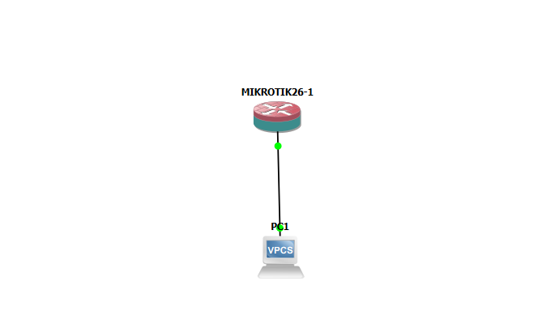
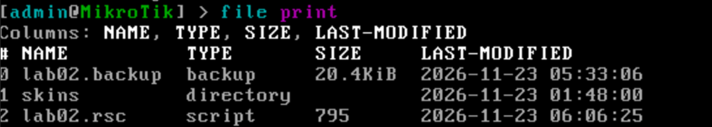
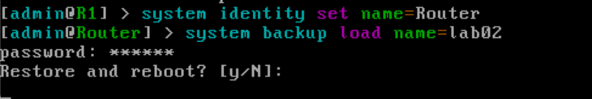
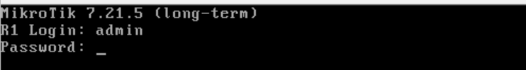
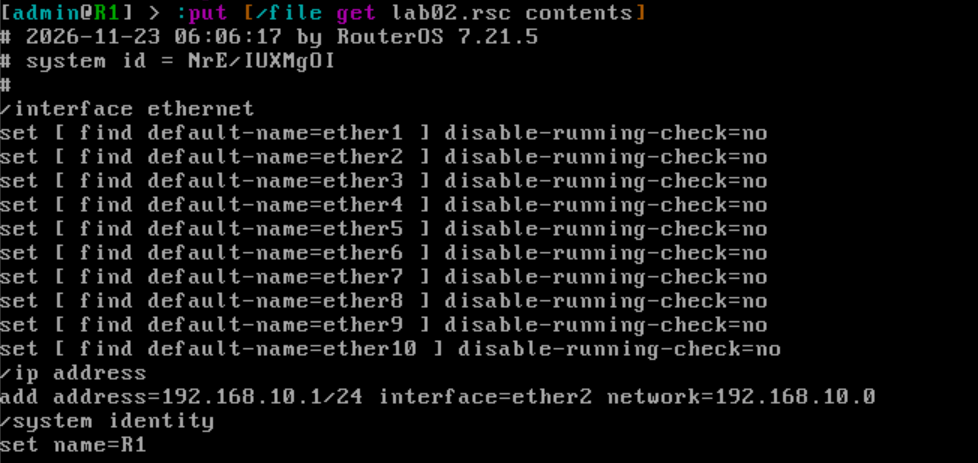
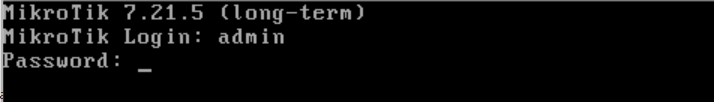
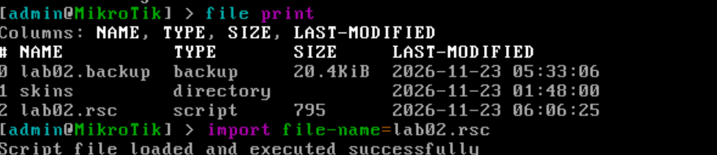

# LAB 02-BACKUP & EXPORT/IMPORT KONFIGURASI ROUTER OS

## Tujuan 

Memahami perbedaan file .backup dan .rsc , lalu menguji keduanya:
memulihkan konfigurasi dari backup, dan memulihkan konfigurasi dari file export setelah router dikosongkan.

## Lingkungan

- Simulator : GNS3 dengan GNS3 VM sebagai server
- Router : Mikrotik CHR, RouterOS versi (isi dari hasil resource print)
- Client : 1 PC virtual (VPCS)

## Topologi

Disini kita pake topologi sebelumnya untuk lab ini.

| Perangkat | Interface | IP Address |
|---|---|---|
| R1 | ether1 | 192.168.10.1/24 |
| PC1 | eth0 | 192.168.10.2/24 |

## Langkah

Berikut perintah yang akan kita jalankan:

### Mengahpus DHCP Client bawaan

/ip dhcp-client print
/ip dhcp-client remove [find]

Router CHR yang kita gunakan memiliki DHCP Client bawaan di ether1. Pada lab ini ether1 tidak dipakai yang kita pakai sesuai lab sebelumnya yaitu ether2. Karena ether1 ini tidak kita pakai sebagai WAN, maka entrinya kita hapus sebelum export.

### Membuat backup dan export

/system backup save name=lab02
/export file=lab02
/file print

Penjelasan:

'/system backup save' membuat lab02.backup , sedangkan '/export file=lab02' membuat lab02.rsc , dan '/file print' menampilkan kedua file.

Perbedaan kedua file:

- Format: file .backup formatnya biner sedangkan file .rsc berisi teks.
- Isi: .backup berisi seluruh konfigurasi termasuk user dan password, sedangkan file .rsc berisi konfigurasi dalam bentuk perintah.
- Cocok untuk: .backup memulihkan perangkat yang sama, sedangkan .rsc dibaca, diedit, dipindah ke router lain, atau disimpan di git.
- Cara pulih: .backup '/system backup load, sedangkan .rsc '/import'.

### Menguji restore dari '.backup'

Nama router kita ubah dulu supaya terlihat perubahannya

/system identity set name=Router
/system backup load name=lab02

ketika diminta untuk konfirm, masukkan password router dan ketik 'y'

Setelah router restart, maka sudah terlihat ditampilan autentikasi router bahwa hostnya sudah ke-reset kembali menjadi 'R1'. Bisa juga dengan setelah login cek dengan 'system identity print' maka hasilnya akan menjadi 'R1'.

### Menguji import dari '.rsc'

Kita perlu periksa 'ip dhcp-client' yang sebelumnya sudah kita remove kita pastikan tidak ada di lab02.rsc contents:

:put [/file get lab02.rsc contents]

Setelah itu, semua konfigurasi di router kita hapus dengan perintah reset, sehingga router kembali seperti awal tanpa konfigurasi apapun:

/system reset-configuration no-defaults=yes skip-backup=yes

konfirmasi dengan 'y'.

penjelasan:

- 'no defaults=yes' berarti konfigurasi bawaan RouterOS tidak dibuat lagi setelah reset.
- 'skip-backup=yes' berarti router tidak membuat backup otomatis sebelum reset.

Router akan restart, login ulang seperti diawal dengan user admin dan password kosong dan masukkan password baru setelahnya.

setelah itu, cek:

/file print
/ip address print

'lab02.rsc' harus dipastikan ada di daftar. setelah itu import file .rsc.

/import file-name=lab02.rsc

Hasilnya bisa diverifikasi dengan:

/ip address print

Memastikan IP Address 192.168.10.1/24 di daftar.

/system identity print

Memasttikan nama router kembali menjadi 'R1'.
