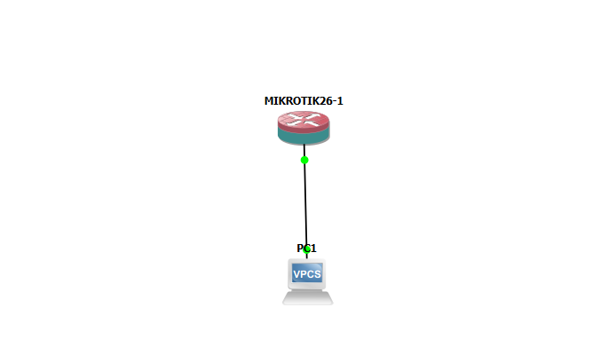
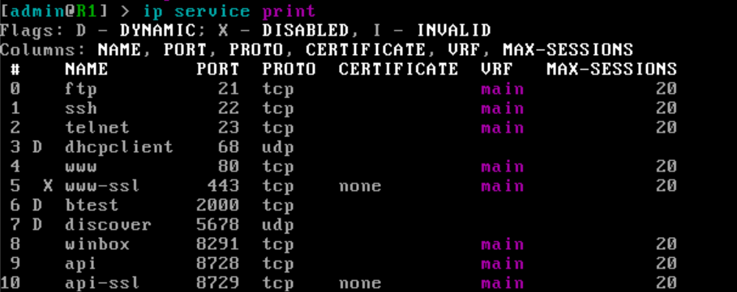
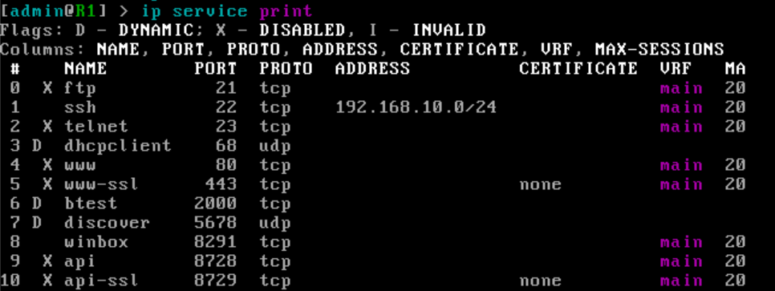

# LAB 03-MANAGE ROUTEROS SERVICES

## Tujuan 

Mengenali service yang berjalan di RouterOS, mematikan service yang tidak dipakai, dan membatasi akses service yang masih dipakai, dan ini sangat baik untuk kemanan jaringan untuk meminimalisir serangan ke router.

## Lingkungan

- Simulator : GNS3 dengan GNS3 VM sebagai server
- Router : Mikrotik CHR, RouterOS versi 7.21.5
- Client : 1 PC virtual (VPCS)

## Topologi

Disini kita pake topologi dengan 1 Router dan 1 PC untuk lab ini.



| Perangkat | Interface | IP Address |
|---|---|---|
| R1 | ether2 | 192.168.10.1/24 |
| PC1 | eth0 | 192.168.10.2/24 |

## Langkah

### Melihat service yang aktif

```routeros
/ip service print
```



Disini kita bisa lihat service yang aktif, dinamis dan tidak aktif.

- Service yang aktif tidak ada tanda.
- Service yang dinamis ditandai dengan huruf 'D'. Artinya Entri dibuat otomatis oleh sistem karena fitur lain sedang berjalan. Entri ini tidak diatur lewat '/ip service' 
- Service yang tidak aktif ditandai dengan huruf 'X'.

Service yang aktif : ftp, telnet, ssh, www, winbox, api, api-ssl.

Service yang tidak aktif : www-ssl.

Service yang dinamis : dhcpclient, btest, discover.
Entri ini tidak diatur lewat '/ip service',  dhcpclient muncul karena router memiliki DHCP client, 'btest' adalah server tes bandwidth, dan 'discover' adalah fitur penemuan perangkat tetangga. ketiganya tidak diubah di lab ini.

### Mematikan service yang tidak dipakai

```routeros
/ip service set ftp disabled=yes
/ip service set telnet disabled=yes
/ip service set www disabled=yes
/ip service set api disabled=yes
/ip service set api-ssl disabled=yes
```


Penjelasan Mengapa dimatikan:

- 'telnet' dan 'ftp' mengirim data tanpa enkripsi, sehingga risikonya paling jelas.
- 'www', 'api', 'api-ssl' tidak dipakai di lab ini.

prinsipnya adalah service yan tidak dipakai sebaiknya tidak aktif.

### Membatasi akses SSH

```routeros
/ip service set ssh address=192.168.10.0/24
```

SSH tetap aktif hanya saja aksesnya hanya dapat di akses di jaringan '192.168.10.0/24'. Perangkat diluar rentang IP tersebut di tolak walaupun servicenya hidup.

### Verifikasi

```routeros
/ip service print
```



Bisa kita lihat hasil perubahan setelah kita matikan beberapa service dan melakukan pembatasan akses pada SSH. SSH disini tetap aktif hanya saja dibatasi dan bisa kita lihat addressnya yang muncul.
