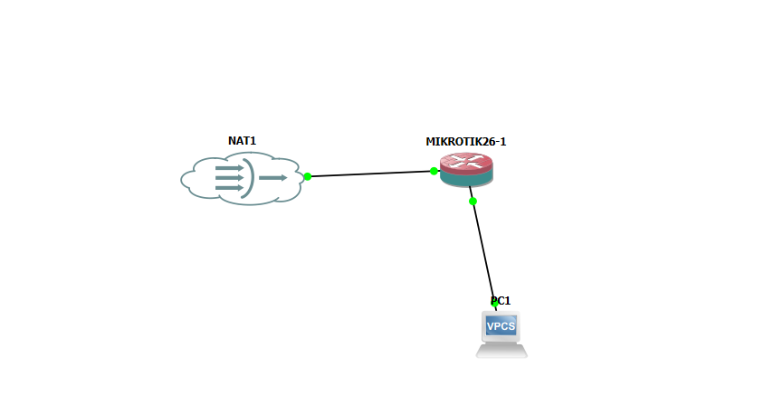
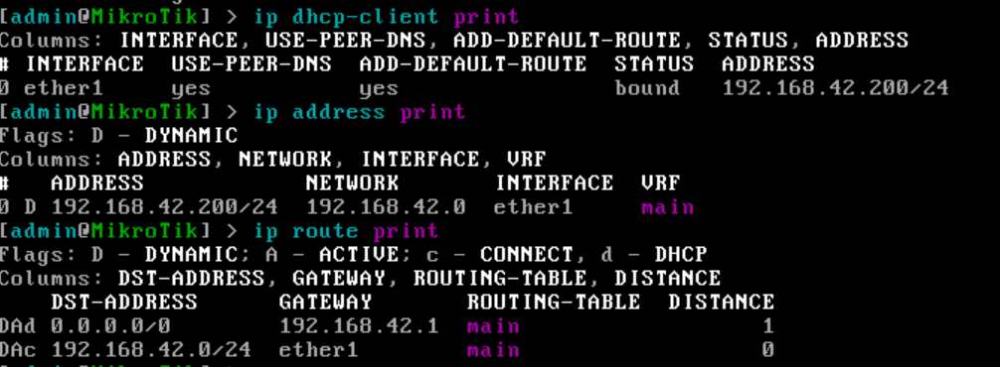
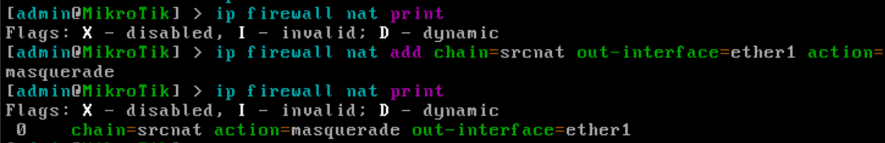
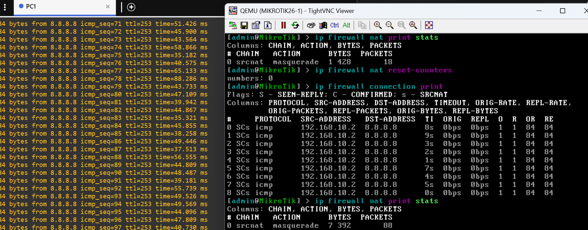
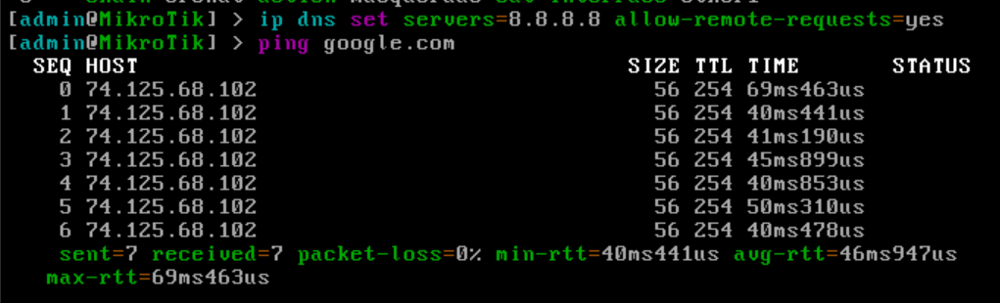
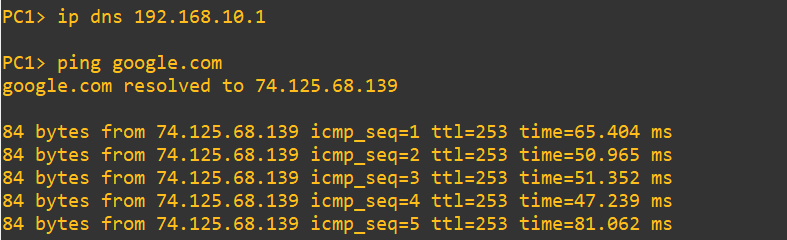

# LAB 04-SETUP KONEKSI INTERNTE VIA ROUTER (NAT, Masquerade, DNS)

## Tujuan 

Memberi router jalur keluar ke internet lewat node NAT di GNS3, lalu membuat PC yang ada di belakang router ikut bisa mengakses internet dengan NAT masquerade dan DNS.

## Lingkungan

- Simulator : GNS3 dengan GNS3 VM sebagai server
- Router : Mikrotik CHR, RouterOS versi 7.21.5
- Node jaringan : 1 node NAT bawaan GNS3
- Client : 1 PC virtual (VPCS)

## Topologi

Disini kita pake topologi dengan 1 node NAT, 1 Router dan 1 PC. Node NAT dihubungkan ke ether1 (jalur WAN) dan PC1 ke ether2 (jalur LAN).



| Perangkat | Interface | IP Address |
|---|---|---|
| R1 | ether1 (WAN) | Dinamis dari node NAT (DHCP) |
| R1 | ether2 (LAN) | 192.168.10.1/24 |
| PC1 | eth0 | 192.168.10.2/24 |

Node NAT dijalankan oleh GNS3 server. Karena server yang dipakai adalah GNS3 VM, node NAT berada di dalam VM, sedangkan GNS3 VM sendiri mendapat internet dari VirtualBox. Jadi paket dari R1 melewati NAT lebih dari sekali sebelum sampai ke internet.

## Langkah

### Memastikan router mendapat IP di ether1

```routeros
/ip dhcp-client print
/ip address print
/ip route print
```



Status dhcp-client harus bound. Alamat dinamis muncul di ether1, dan ada rute default 0.0.0.0/0 lewat gateway node NAT.

### Menyiapkan Jaringan LAN

Di Router:

```routeros
/system identity set name=R1
/ip address add address=192.168.10.1/24 interface=ether2
```

Pada PC1:

```
ip 192.168.10.2/24 192.168.10.1
```

### Menguji internet dari router

```routeros
/ping 8.8.8.8 count=4
```
Ping ke alamat IP dipakai lebih dulu karena tidak melibatkan DNS, sehingga hasil langsung menunjukan apakah jalur internet berfungsi atau tidak.

### Memasang NAT masquerade

Pada tahap ini router sudah bisa internet tetapi PC1 belum, karena alamat 192.168.10.2 adalah alamat privat yang tidak dikenal di luar. Router perlu mengganti alamt sumber paket PC1 dengan ether1 miliknya.

```routeros
/ip firewall nat add chain=srcnat out-interface=ether1 action=masquerade
/ip firewall nat print
```


Penjelasan:

- chain=srcnat berlaku untuk paket yang keluar dan perlu diubah alamat sumbernya.
- out-interface=ether1 hanya memproses paket yang keluar lewat WAN.
- action=masquerade mengganti alamat sumber dengan alamat IP ether1 secara otomatis, cocok untuk IP WAN yang didapat dari DHCP dan bisa berubah.

### Menguji internet dari PC1

```
ping 8.8.8.8
```
Lakukan pengujian dengan nge-ping ke 8.8.8.8 untuk memastikan Internet dengan IP dapat diakses.

### Membuktikan bahwa NAT bekerja

Counter aturan di reset dulu supaya kenanikan angka berasal dari trafik baru:

```routeros
/ip firewall nat reset-counters numbers=0
```
Pada PC1, ping jalankan secara terus menerus:

```
ping 8.8.8.8 -t
```
Sambil ping berjalan, buka router:

```routeros
/ip firewall connection print
/ip firewall nat print stats
```



Pada tabel koneksi terlihat alamat sumber 192.168.10.2 (PC1) dan alamat balasan berada di ether1. Perbedaan kedua alamat itu adalah bukti NAT mengganti alamat sumber. Angka paket pada nat print stats juga naik selama ping berjalan.

### Mengatur DNS

```routeros
/ip dns set servers=8.8.8.8 allow-remote-requests=yes
/ping google.com count=4
```



Pada PC1:

```
ip dns 192.168.10.1
ping google.com
```



Penjelasannya:

- servers=8.8.8.8 menentukan server DNS yang ditanya router.
- allow-remote-request=yes membuat router melayani permintaan DNS dari perangkat lain, termasuk PC1.
- ip dns pada VPCS memberi tahu PC1 untuk bertanya DNS ke router.


Hasil terjemahan nama bisa dilihat di cache DNS router:

```routeros
/ip dns cache print
```