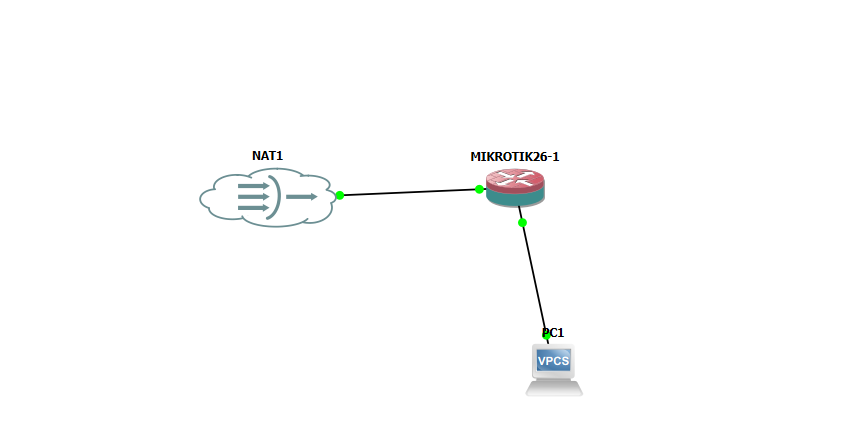
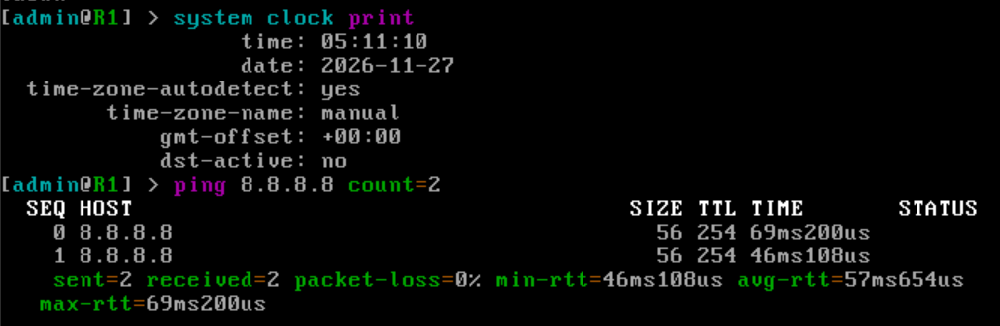

# LAB 05-KONFIGURASI ZONA WAKTU & NTP CLIENT

## Tujuan 

Mengatur zona waktu router sesuai lokasi disini saya menggunakan WITA dan mengaktifkan NTP client supaya jam router disinkronkan dengan server waktu di internet.

## Topologi

Disini kita pake topologi LAB 04 yang dimana sudah ada konfigurasi NAT nya, dengan 1 node NAT, 1 Router dan 1 PC. Node NAT dihubungkan ke ether1 (jalur WAN) dan PC1 ke ether2 (jalur LAN).



| Perangkat | Interface | IP Address |
|---|---|---|
| R1 | ether1 (WAN) | Dinamis dari node NAT (DHCP) |
| R1 | ether2 (LAN) | 192.168.10.1/24 |
| PC1 | eth0 | 192.168.10.2/24 |

## Langkah

### Memeriksa kondisi awal

```routeros
/system clock print
/ping 8.8.8.8 count=2
```



### Memastikan router bisa menerjemahkan nama server NTP

Di Router:

```routeros
ping id.pool.ntp.org count=2
```
Server NTP dipanggil dengan nama, jadi router harus bisa menerjemahkan nama itu lewat DNS. Pengaturan ini sudah dibuat di LAB 04.

### Mengatur zona waktu

```routeros
/system clock set time-zone-autodetect=no time-zone-name=Asia/Makassar
/system clock print
```


Penjelasan:
- 'time-zone-autodetect=no' mematikan deteksi otomatis untuk mencegah waktu yang diatur tidak tertimpa.
- 'time-zone-name=Asia/Makassar' adalah nama zona waktu WITA, yang saya pake.
- Zona waktu adalah cara jam ditampilkan, sedangkan NTP menentukan seberapa akurat jam tersebut.

Setelah dilakukan perubahan, 'gmt-offset' menjadi '+08:00' dan jam router bergeser 8 jam.

### Mengaktifkan NTP client

Pada tahap ini router sudah bisa internet tetapi PC1 belum, karena alamat 192.168.10.2 adalah alamat privat yang tidak dikenal di luar. Router perlu mengganti alamt sumber paket PC1 dengan ether1 miliknya.

```routeros
/system ntp client set enabled=yes
/system ntp client set servers add address=id.pool.ntp.org
/system ntp client print
```


Penjelasan:

- perintah pertama menyalakan NTP client
- perintah kedua menambahkan server waktu. 'id.pool.ntp.org' adalah kumpulan server NTP di Indonesia.
- perintah terakhir menampilkan status client. Pada lab yang berjalan lambat, status butuh waktu sebelum berubah menjadi 'sysnchronized'.

### Verifikasi

```routeros
/system clock print
```


Jam router sudah sama dengan jam di laptop saya dan zona waktunya WITA.
