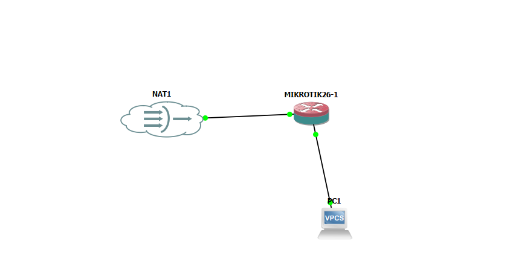
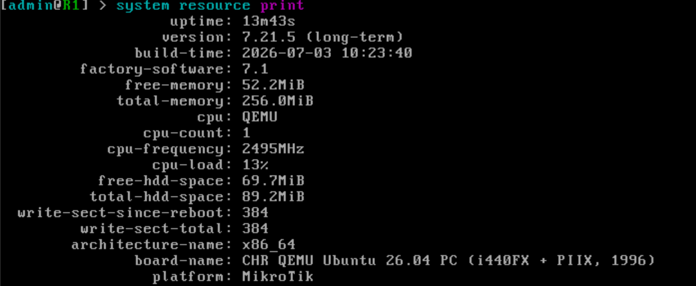
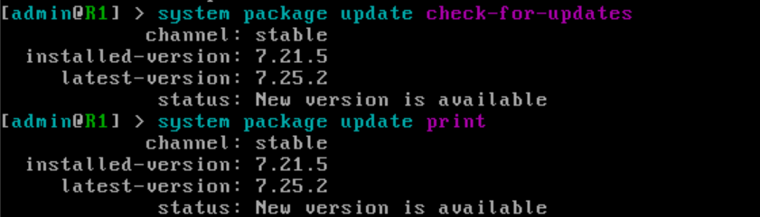
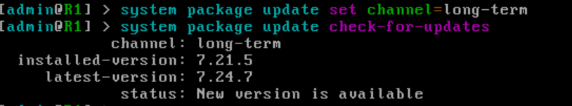

# LAB 06-LISENSI ROUTEROS, RESOURCE, dan CEK UPDATE

## Tujuan 

Mengenali lisensi dan spesifikasi router yang dipakai, lalu mengecek apakah ada versi RouterOS yang lebih baru beserta pengaruh pemilihan channel update. Pada lab ini upgrade tidak dijalankan.

## Topologi

Disini kita pake topologi LAB 05 yang dimana sudah ada konfigurasi NAT nya, dengan 1 node NAT, 1 Router dan 1 PC. Node NAT dihubungkan ke ether1 (jalur WAN) dan PC1 ke ether2 (jalur LAN).



| Perangkat | Interface | IP Address |
|---|---|---|
| R1 | ether1 (WAN) | Dinamis dari node NAT (DHCP) |
| R1 | ether2 (LAN) | 192.168.10.1/24 |
| PC1 | eth0 | 192.168.10.2/24 |

## Langkah

### Melihat lisensi

```routeros
/system license print
```


Hasilnya menampilkan 'level:free'. Pada CHR, level ini adalah lisensi gratis yang membatasi kecepatan. Selain level, ada 'system-id' yang menjadi pengenal unik router ini.

### Melihat resource router

```routeros
/system resource print
```



| Baris | Nilai | Artinya |
|---|---|---|
| version | 7.21.5 (long-term) | Versi terpasang, berasal dari jalur rilis long-term |
| build-time | 2026-07-03 | Tanggal build versi ini |
| factory-software | 7.1 | Versi awal saat image CHR dibuat |
| total-memory / free-memory | 256 MiB / 52.2 MiB | Sisa RAM sekitar 20% |
| cpu / cpu-count | QEMU / 1 | Router berjalan di emulasi QEMU dengan 1 core |
| cpu-load | 13% | Beban CPU saat dicek |
| total-hdd-space / free-hdd-space | 89.2 MiB / 69.7 MiB | Disk virtual berukuran kecil |
| architecture-name | x86_64 | Arsitektur CHR |
| board-name | CHR QEMU Ubuntu 26.04 PC (i440FX + PIIX, 1996) | CHR berjalan sebagai VM QEMU |

### Mengecek update di channel stable

```routeros
/system package update check-for-updates
/system package update print
```


| Channel | Versi terpasang | Versi terbaru yang ditawarkan |
|---|---|---|
| stable | 7.21.5 | 7.25.2 |


Status yang tampil adalah `New version is available`. Perintah ini hanya membandingkan versi dan tidak mengunduh atau memasang apa pun.

### 4. Membandingkan dengan channel long-term

```
/system package update set channel=long-term
/system package update check-for-updates
```



| Channel | Versi terpasang | Versi terbaru yang ditawarkan |
|---|---|---|
| stable | 7.21.5 | 7.25.2 |
| long-term | 7.21.5 | 7.24.7 |

Router yang sama mendapat jawaban berbeda tergantung channel yang dipilih. Channel stable menawarkan versi yang lebih baru daripada long-term. 
Menurut pemahaman saya, jalur long-term dipakai untuk versi yang diprioritaskan stabilitasnya dan perubahannya lebih sedikit, 
sedangkan stable membawa fitur lebih baru. Definisi resminya perlu dicek di dokumentasi MikroTik.

Setelah percobaan, channel dikembalikan ke kondisi awal:

```
/system package update set channel=stable
```